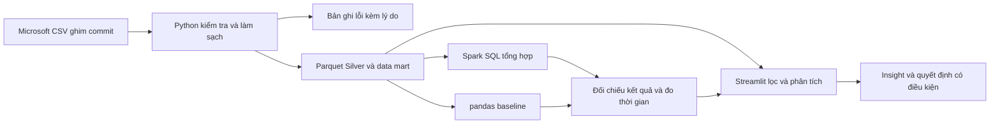

# RetailInsight — Multi-Channel Revenue and Profit Analytics

**Pipeline dữ liệu và dashboard phân tích hiệu quả bán lẻ đa kênh.**

Dự án xây dựng quy trình từ dữ liệu nguồn đến dashboard phục vụ quản lý bán hàng và tài chính. Hai câu hỏi chính: kênh doanh thu cao có đồng thời sinh lợi cao không; danh mục và vùng nào đáng ưu tiên kiểm tra để cải thiện hiệu quả?

Pipeline nạp dữ liệu Microsoft AdventureWorksDW, kiểm tra chất lượng, tạo data mart Parquet, tổng hợp bằng Spark SQL và đối chiếu với pandas. Dashboard Streamlit cho phép lọc và tải kết quả phân tích bằng tiếng Việt.

**Nguồn dữ liệu:** AdventureWorks là dữ liệu doanh nghiệp **giả lập** do Microsoft cung cấp theo giấy phép MIT. Các kết quả phục vụ minh họa phân tích và kiểm chứng kỹ thuật, không đại diện cho thị trường thực tế.

[Báo cáo kỹ thuật](docs/BAO_CAO.md) · [Báo cáo PDF](output/Bao_cao_pipeline_dashboard.pdf) · [Nguồn dữ liệu](docs/DATA_SOURCES.md) · [Kiểm chứng](docs/VALIDATION.md) · [Demo](docs/DEMO.md)

## Nội dung

- [Dashboard](#dashboard)
- [Cài đặt và khởi chạy](#cài-đặt-và-khởi-chạy)
- [Dữ liệu và kết quả tham chiếu](#dữ-liệu-và-kết-quả-tham-chiếu)
- [Kiến trúc](#kiến-trúc)
- [Công thức KPI](#công-thức-kpi)
- [Tái lập thực nghiệm](#tái-lập-thực-nghiệm)
- [Cấu trúc repository](#cấu-trúc-repository)
- [Kiểm thử và giới hạn](#kiểm-thử-và-giới-hạn)
- [Tài liệu và giấy phép](#tài-liệu-và-giấy-phép)

## Dashboard


[Xem bộ ảnh và biên bản kiểm tra giao diện](docs/SCREENSHOT_REVIEW.md). Ảnh được chụp tại thời điểm kiểm chứng; bố cục có thể khác giữa các phiên bản.

- **Tổng quan:** doanh thu, lợi nhuận gộp, biên gộp, tăng trưởng tháng, xu hướng và nhận xét theo bộ lọc.
- **Kênh và thị trường:** so sánh Internet/Reseller, hiệu quả vùng, bảng và CSV bằng USD.
- **Sản phẩm:** tìm theo danh mục, xếp hạng lợi nhuận cao/thấp, giữ cả sản phẩm lỗ.
- **Dữ liệu và kiểm chứng:** chất lượng trước–sau, benchmark, công thức và truy vết nguồn.

Thanh bên hỗ trợ khoảng ngày, kỳ chung hai kênh, kênh bán, vùng, danh mục, đại lý và sản phẩm. Thay đổi bộ lọc cập nhật đồng thời KPI, biểu đồ, bảng và CSV kinh doanh. Trang kiểm chứng sử dụng toàn bộ run và được ghi nhãn riêng. Có nút đặt lại và thông báo cho ngày thiếu, ngày đảo chiều hoặc phạm vi không có dữ liệu.

## Cài đặt và khởi chạy

```bash
git clone https://github.com/winter-1402/RetailInsight-Multi-Channel-Revenue-and-Profit-Analytics.git
cd RetailInsight-Multi-Channel-Revenue-and-Profit-Analytics
git switch feat/assignment-completion-20261116
```

Yêu cầu: **Python 3.11 hoặc 3.12**, **JDK 17+**, `JAVA_HOME` trỏ đến JDK. Không cần SQL Server, SSMS, Docker, Hadoop/HDFS, Power BI hoặc tài khoản Kaggle.

### Windows

```powershell
python -m venv .venv
.\.venv\Scripts\python.exe -m pip install --no-cache-dir -r requirements.txt
.\run.cmd all
.\run.cmd dashboard
```

Mở **http://127.0.0.1:8501**. Nếu đã có dữ liệu và môi trường, chỉ cần `run.cmd dashboard`.

`run.cmd` dùng được khi PowerShell chặn script `.ps1`; không cần đổi execution policy. Kiểm tra `JAVA_HOME` bằng `echo $env:JAVA_HOME`; Spark dùng JDK tại biến này. Nên dành khoảng 3 GB dung lượng trống cho cài đặt và file tạm.

### Linux và macOS

```bash
python3 -m venv .venv
source .venv/bin/activate
python -m pip install -r requirements.txt
python -m src.pipeline.retail --download
python -m src.benchmark.mart --repeats 3
python -m src.utils.report
python -m src.utils.delivery --verify --package
python -m streamlit run dashboard/dashboard.py
```

Xuất PDF tiếng Việt cần Arial trên Windows hoặc DejaVu Sans trên Linux (`fonts-dejavu-core`). macOS có thể cung cấp cặp font hợp lệ trong `assets/fonts/`; xem hàm `register_fonts` trong `src/utils/report.py`.

## Dữ liệu và kết quả tham chiếu

[**Mở dataset chính thức của Microsoft**](https://github.com/microsoft/sql-server-samples/tree/b47eadc85277f72843647223cde53aa1b85ffcb8/samples/databases/adventure-works/data-warehouse-install-script)

Nguồn được ghim commit `b47eadc85277f72843647223cde53aa1b85ffcb8`: 8 bảng, **121.253 dòng bán hàng**, **31.455 đơn**, từ **29/12/2010 đến 28/01/2014**. Script tự tải CSV; không phải tải hoặc khôi phục file `.bak`.

| Chỉ số | Giá trị |
|---|---:|
| Doanh thu sau chiết khấu | 109.809.274,2030 USD |
| Giá vốn | 97.257.907,9547 USD |
| Lợi nhuận gộp | 12.551.366,2483 USD |
| Biên lợi nhuận gộp | 11,430151% |
| Tăng trưởng 10/2013 so với 09/2013 | +36,4968% |


*Hình tổng hợp được sinh trực tiếp từ data mart, không phải ảnh chụp giao diện.*

Reseller kết thúc ghi nhận ngày 29/11/2013, Internet ngày 28/01/2014. KPI tăng trưởng chỉ dùng cặp tháng nằm trọn trong phạm vi nguồn của kênh đang chọn và khoảng lọc. Không diễn giải mức giảm ở biên dataset thành suy giảm nhu cầu. Cờ đủ kỳ chỉ xét biên thời gian, không bảo đảm nguồn không bỏ sót giao dịch.

## Kiến trúc



Mart có grain **một dòng mặt hàng trong đơn**. Khóa gồm kênh, số đơn và số dòng. Ghép chiều nhiều-một có kiểm tra; không cho phép nhân đôi doanh thu. Mỗi lần nạp tạo run riêng, chỉ công bố `current.txt` sau khi hoàn tất. Lỗi nạp không thay thế lượt thành công trước đó.

## Công thức KPI

| KPI | Công thức |
|---|---|
| Doanh thu thuần | SUM(SalesAmount); nguồn đã trừ DiscountAmount |
| Lợi nhuận gộp | SUM(SalesAmount − TotalProductCost) |
| Biên gộp | Tổng lợi nhuận gộp / tổng doanh thu × 100 |
| Tăng trưởng tháng | (Doanh thu tháng / doanh thu tháng lịch trước − 1) × 100 |

Tiền giữ bằng số nguyên **1/10.000 USD**, chỉ làm tròn khi hiển thị. Không trừ chiết khấu hai lần, không lấy trung bình biên từng dòng, không loại giao dịch lỗ. Mẫu số 0 hoặc chưa có kỳ trước trả về không xác định. Lợi nhuận gộp chưa trừ marketing/vận hành; nguồn không có hoàn trả để điều chỉnh thêm.

## Tái lập thực nghiệm

[Kế hoạch kiểm thử Spark SQL, baseline và bộ truy vấn Q1–Q8](docs/SPARK_SQL_TEST_PLAN.md).

```powershell
.\run.cmd pipeline     # tải nếu thiếu, kiểm tra, tạo mart
.\run.cmd benchmark    # 3 workload × 3 lần × 2 công cụ
.\run.cmd sql-benchmark # Q1–Q8 × 5 lần × pandas/Spark SQL
.\run.cmd load-test    # tùy chọn: 5 bản sao để thử tải
.\run.cmd test         # kiểm thử và lưu log
.\run.cmd report       # PDF và hình tổng hợp từ dữ liệu hiện hành
.\run.cmd package      # xuất minh chứng và gói phân phối ZIP
```

Benchmark mart dùng cùng Parquet, cùng cột và phép tổng hợp; mốc đo gồm đọc, tổng hợp, distinct, sắp xếp và trả kết quả. Khởi động JVM đo riêng; không loại lượt đầu và không xóa cache hệ điều hành. Kết quả được so sánh chính xác **từng nhóm**, không chỉ tổng chung.

Bộ Q1–Q8 đọc chín bảng AdventureWorks riêng để đo filter, JOIN, GROUP BY và window. Mã và SQL nằm trong `src/benchmark/`, kiểm thử trong `tests/benchmark/`; kết quả lưu tại [output/sql_benchmark](output/sql_benchmark/README.md). Q1 dùng ngưỡng 100 USD; Q7 nhóm theo loại hình đại lý vì nguồn không có phương thức thanh toán giao dịch.

Q1–Q8 nạp CSV đã kiểm tra vào pandas và temporary view Spark một lần trước phép đo; truy vấn chạy trong bộ nhớ, không đọc/ghi Parquet. Run mới chỉ có thư mục `results/` và `plans/`, không tạo `tables/` hoặc `queries/`; SQL thực thi và hash được lưu trong `environment.json`. Thời gian chuẩn bị và nạp bảng Spark được ghi riêng. Không so trực tiếp thời gian mới với run Parquet cũ.

Trên máy mới, tải các bảng còn thiếu (file nguồn đã có được giữ nguyên), sau đó chạy:

```bash
python -c "from src.ingestion.source import download; from src.benchmark.prepare import DIMENSIONS, FACTS; download(tables=[*DIMENSIONS, *FACTS])"
python -m src.benchmark.runner --repeats 5
```

Trong lượt đo mart tham chiếu, pandas nhanh hơn Spark SQL ở cả ba truy vấn. Overhead JVM, lập kế hoạch và thu thập kết quả có thể chi phối ở quy mô local này. Các con số và cấu hình nằm tại [output/evidence](output/evidence); thời gian thay đổi theo môi trường. Thử tải 5× là tùy chọn, tách khỏi phân tích kinh doanh. Kết quả không chứng minh khả năng mở rộng trên cụm phân tán.

## Cấu trúc repository

```text
dashboard/
├── dashboard.py            giao diện Streamlit
└── assets/dashboard.css    giao diện và bố cục thích ứng
src/
├── ingestion/source.py     tải nguồn ghim phiên bản, đọc schema SQL
├── cleaning/source.py      chuẩn hóa, kiểm tra và cách ly bản ghi lỗi
├── pipeline/
│   ├── retail.py           ghép chiều, dựng mart, công bố run và lineage
│   └── analytics.py        bộ lọc, KPI tháng, tổng hợp, CSV
├── benchmark/
│   ├── prepare.py          chuẩn bị chín bảng, kiểm tra khóa và hash nguồn
│   ├── queries.py          baseline pandas và thực thi Spark SQL Q1–Q8
│   ├── runner.py           đo Q1–Q8, đối chiếu và xuất kết quả
│   ├── mart.py             benchmark ba tổng hợp mart, thử tải tùy chọn
│   └── sql/Q1.sql…Q8.sql   truy vấn benchmark trên các bảng riêng
└── utils/
    ├── config.py           đường dẫn dự án và đơn vị tiền dùng chung
    ├── files.py            SHA-256 dùng chung
    ├── report.py           báo cáo PDF và hình dữ liệu
    └── delivery.py         log kiểm thử, minh chứng và ZIP
.streamlit/config.toml      chủ đề và cấu hình local
sql/retail/                 SQL tổng hợp và phân khúc
tests/                      kiểm thử đơn vị và tích hợp
└── benchmark/              kiểm thử mart và Q1–Q8 bằng Spark thực
tasks/                      kế hoạch và checklist thực hiện
docs/                       báo cáo, nguồn, demo, hướng dẫn GitHub
output/                     báo cáo PDF, minh chứng và ZIP local
└── sql_benchmark/          số đo, kết quả, plans và cấu hình Q1–Q8 theo run
data/raw/                   CSV nguồn Microsoft, schema và giấy phép
data/adventureworks/         warehouse sinh theo run, không đưa lên Git
```

## Kiểm thử và giới hạn

Kiểm thử bao gồm tiền/chiết khấu, giao dịch lỗ, khóa và phép ghép, tháng trống, phạm vi kỳ tăng trưởng, CSV, thay đổi bộ lọc, reset, dữ liệu rỗng, Spark thực, PDF và gói bàn giao. Chi tiết: [docs/VALIDATION.md](docs/VALIDATION.md).

Bộ kiểm thử kiểm tra phép tính KPI, bộ lọc dashboard và kết quả tổng hợp. Xem [log kiểm thử](output/evidence/tests.log) và [mã thoát](output/evidence/test_status.json).

Phạm vi hiện tại dùng Spark `local[2]`, lưu trữ trên filesystem và phục vụ dashboard local. Chưa kiểm chứng vận hành phân tán, nhiều người dùng đồng thời hoặc triển khai công khai có xác thực. Lợi nhuận gộp chưa bao gồm đầy đủ chi phí vận hành, marketing và hoàn trả.

## Tài liệu và giấy phép

| Tài liệu | Nội dung |
|---|---|
| [Nguồn dữ liệu](docs/DATA_SOURCES.md) | Link tải, schema, giấy phép và phạm vi dữ liệu |
| [Báo cáo kỹ thuật](docs/BAO_CAO.md) | Phương pháp, KPI, thực nghiệm và nhận xét |
| [Phạm vi chức năng](docs/REQUIREMENTS.md) | Yêu cầu và liên kết minh chứng |
| [Rà soát kỹ thuật](docs/COMPLIANCE_REVIEW.md) | Trạng thái triển khai và giới hạn |
| [Kiểm chứng](docs/VALIDATION.md) | Phương pháp kiểm thử, log và môi trường |
| [Kiểm tra giao diện](docs/SCREENSHOT_REVIEW.md) | Ảnh chụp thực tế và xác nhận từng bước |
| [Demo](docs/DEMO.md) | Kịch bản kiểm tra ứng dụng |

Mã nguồn được phân phối theo [MIT License](LICENSE). Thông báo bên thứ ba được giữ tại [THIRD_PARTY_NOTICES.md](THIRD_PARTY_NOTICES.md). Việc sử dụng công cụ AI được công khai tại [docs/AI_USAGE.md](docs/AI_USAGE.md).
