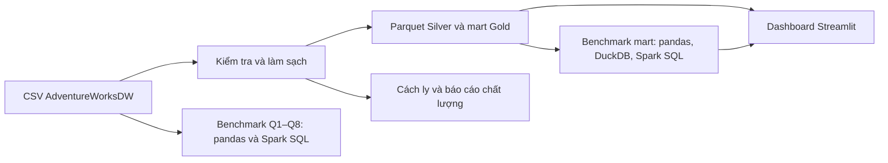

# RetailInsight

**Phân tích doanh thu và lợi nhuận bán lẻ đa kênh** · Bài tập lớn CO4033

RetailInsight giúp quản lý bán hàng và tài chính xác định kênh có doanh thu cao nhưng biên gộp thấp, tìm danh mục và vùng đóng góp lợi nhuận, rồi truy vết kết quả về dữ liệu đã kiểm tra. Dự án dùng dữ liệu doanh nghiệp giả lập **Microsoft AdventureWorksDW** theo giấy phép MIT.

[Báo cáo CO4033 PDF](docs/reports/Bao_cao_CO4033_RetailInsight.pdf) · [Bản Word](docs/reports/Bao_cao_CO4033_RetailInsight.docx) · [Hướng dẫn demo](docs/DEMO.md) · [Minh chứng](output/evidence)


## Chạy nhanh trên Windows

Cần **Python 3.12 64-bit**, Git để clone và kết nối mạng cho lần cài đặt đầu tiên. **JDK 17 hoặc 21** dùng cho benchmark và bộ kiểm thử Spark. Hai lệnh nạp dữ liệu và mở dashboard chạy trong Python.

```powershell
git clone --branch finish/retailinsight https://github.com/winter-1402/RetailInsight-Multi-Channel-Revenue-and-Profit-Analytics.git
cd RetailInsight-Multi-Channel-Revenue-and-Profit-Analytics
.\setup.cmd
.\run.cmd pipeline
.\run.cmd dashboard
```

Mở **http://127.0.0.1:8501**. Script cài các phiên bản trong `requirements.txt` vào `.venv`, tách thư viện Python toàn máy và kiểm tra tương thích bằng `pip check`. PowerShell có thể chạy trực tiếp các tệp `.cmd` với execution policy hiện có.

### Chạy theo mục tiêu

| Lệnh Windows | Kết quả |
|---|---|
| `run.cmd pipeline` | Tải các CSV cần thiết nếu còn thiếu, kiểm tra, lưu Silver và tạo mart Gold. |
| `run.cmd dashboard` | Mở dashboard Streamlit trên cổng 8501. |
| `run.cmd benchmark` | Đo 4 nhóm truy vấn trên mart 1× bằng pandas, DuckDB và Spark SQL, 3 lượt mỗi công cụ. |
| `run.cmd load-test` | Đo lại trên 606.265 dòng nhân bản 5×, ghi riêng với dữ liệu kinh doanh. |
| `run.cmd sql-benchmark` | Đo 8 truy vấn JOIN, filter, group và window bằng pandas/Spark SQL, 5 lượt mỗi công cụ. |
| `run.cmd test` | Chạy pytest, lưu trạng thái và xuất minh chứng từ lượt nạp hiện hành. |
| `run.cmd report` | Tạo PDF kỹ thuật, Markdown và biểu đồ từ lượt nạp đã benchmark. |
| `run.cmd package` | Xuất minh chứng và gói ZIP với mã nguồn, SQL, tài liệu và dữ liệu mẫu. |
| `run.cmd all` | Nạp dữ liệu, đo 1×, xuất báo cáo kỹ thuật, kiểm thử và đóng gói. |
| **`run.cmd technical`** | Thực hiện `all` cùng thử tải 5× và bộ Q1–Q8. Dùng để kiểm chứng toàn bộ bài. |

### Linux và macOS

Với Python 3.12 và `JAVA_HOME` trỏ tới JDK 17 hoặc 21, chạy tại thư mục kho mã.

```bash
python3.12 -m venv .venv
source .venv/bin/activate
python -m pip install -r requirements.txt
python -m pip check
python -m src.pipeline.retail --download
python -m src.benchmark.mart --repeats 3
python -m src.benchmark.mart --scale 5 --repeats 3
python -m src.benchmark.runner --repeats 5
python -m src.utils.report
python -m src.utils.delivery --verify --package
python -m streamlit run dashboard/dashboard.py --server.address 127.0.0.1
```

PDF kỹ thuật dùng Arial trên Windows hoặc DejaVu Sans trên Linux. Trên macOS có thể cài DejaVu Sans hoặc dùng cặp font tương thích trong `assets/fonts/` theo [mã tạo báo cáo](src/utils/report.py).

## Kết quả kinh doanh

**121.253 dòng bán hàng · 31.455 đơn · 29/12/2010 đến 28/01/2014**

| KPI | Giá trị | Cách tính |
|---|---:|---|
| Doanh thu thuần | 109.809.274,20 USD | Tổng `SalesAmount` sau chiết khấu. |
| Lợi nhuận gộp | 12.551.366,25 USD | Doanh thu thuần trừ tổng `TotalProductCost`. |
| Biên lợi nhuận gộp | 11,4302% | Lợi nhuận gộp chia doanh thu thuần × 100. |
| Tăng trưởng tháng 10/2013 | +36,4968% | Tỷ lệ thay đổi so với 09/2013 trong phạm vi đủ kỳ cho hai kênh. |

Reseller chiếm **73,26%** doanh thu nhưng biên gộp chỉ **0,58%**. Internet đạt biên **41,15%**. Xe đạp đóng góp **83,78%** lợi nhuận gộp, trong đó Xe đạp tại Reseller lỗ gộp khoảng **990.700 USD**. Kết quả gợi ý rà soát giá vốn và chiết khấu nhóm này theo đại lý trước khi thay đổi chính sách bán. Cần thêm dữ liệu vận hành, marketing, hoàn trả và tồn kho để đánh giá quyết định trên dữ liệu thật.

Dashboard có các trang **Tổng quan**, **Kênh và thị trường**, **Sản phẩm**, **Dữ liệu và kiểm chứng**. Các KPI, biểu đồ, bảng và CSV kinh doanh dùng cùng bộ lọc ngày, kênh, vùng, danh mục, sản phẩm và đại lý. Chọn **Kỳ chung hai kênh** để đối chiếu 01/01/2011 đến 31/10/2013. [Ảnh giao diện và ca kiểm chứng](docs/SCREENSHOT_REVIEW.md)

## Kiến trúc và thực nghiệm



Mart lưu một dòng cho mỗi mặt hàng trên đơn, khóa gồm kênh, số đơn và số dòng. Tiền dùng số nguyên theo **1/10.000 USD** để so khớp chính xác. Mỗi lượt nạp ghi manifest, hash nguồn và bảng chất lượng trước–sau. `current.txt` chuyển sang lượt mới sau khi mart hoàn thành. [Nguồn và schema](docs/DATA_SOURCES.md)

| Thực nghiệm | Thiết kế | Minh chứng |
|---|---|---|
| Mart, 1× và 5× | Cùng Parquet, cùng phép tính. Đo từ mở tệp đến nhận bảng kết quả. Ghi min, trung vị và max, so khớp từng dòng nhóm với pandas. | [1×](output/evidence/benchmark_summary.csv) · [5×](output/evidence/load_scale_5_benchmark_summary.csv) · [Cấu hình](output/evidence/benchmark_environment.json) · [EXPLAIN](output/evidence/sql_plans.txt) |
| Q1–Q8 | Dùng các bảng đã nạp vào pandas và Spark temporary views. Đo riêng thời gian chuẩn bị và khởi động Spark. | [Run và cấu hình](output/sql_benchmark/README.md) · [Kế hoạch kiểm thử](docs/SPARK_SQL_TEST_PLAN.md) |
| Tính đúng và khả năng tái lập | Kiểm tra KPI từ CSV gốc, khóa, ngoại lệ, lọc/reset, trường hợp dữ liệu rỗng, kết quả Spark thực và gói ZIP. | [Biên bản kiểm chứng](docs/VALIDATION.md) · [Log pytest](output/evidence/tests.log) |

Hai bộ benchmark đo hai kiểu tải khác nhau. Mỗi kết quả mô tả cấu hình local đã ghi trong minh chứng. Khả năng mở rộng trên cụm phân tán cần được đo riêng.

## Cấu trúc kho mã

```text
dashboard/          Ứng dụng Streamlit và CSS
src/ingestion/      Tải dữ liệu ghim phiên bản và đọc schema nguồn
src/cleaning/       Chuẩn hóa, kiểm tra và cách ly dòng lỗi
src/pipeline/       Data mart và logic KPI dùng chung
src/benchmark/      Bộ đo Parquet và Q1–Q8
src/utils/          Báo cáo kỹ thuật, xuất minh chứng và ZIP
sql/retail/         Truy vấn mart và phân khúc
sql/benchmarks/     Nguồn SQL duy nhất của Q1–Q8
tests/              Kiểm thử đơn vị, tích hợp và dashboard
docs/reports/       Báo cáo CO4033 PDF và Word bản công khai
output/             Minh chứng thực thi và báo cáo kỹ thuật
data/raw/           Dữ liệu mẫu và DDL Microsoft
```

## Xử lý lỗi môi trường

| Triệu chứng | Kiểm tra và khắc phục |
|---|---|
| `No module named ...` hoặc import lỗi trong VS Code | Chạy `setup.cmd`. Dùng **Python: Select Interpreter** để chọn `.venv\Scripts\python.exe` của kho mã đang mở. |
| `pip check` báo gói ngoài dự án xung đột | Chạy `.venv\Scripts\python.exe -m pip check` trong kho mã. `setup.cmd` dựng lại cấu hình venv ở chế độ tách thư viện hệ thống. |
| `py` mặc định trỏ Python khác | Dùng Python 3.12 64-bit trên PATH hoặc `py -3.12`. Với venv thuộc Python khác, đổi tên thư mục `.venv` rồi chạy lại `setup.cmd`. |
| Java 8 hoặc `JAVA_HOME` cũ | Đặt `JAVA_HOME` vào thư mục gốc JDK 17 hoặc 21. Benchmark kiểm tra Java được chọn trước khi khởi động Spark. |
| Dashboard báo chưa có mart hoặc benchmark | Chạy `run.cmd pipeline` để tạo mart, sau đó `run.cmd benchmark` để mở bảng Hiệu năng. |

[Hướng dẫn VS Code](https://code.visualstudio.com/docs/python/environments) · [Yêu cầu Java của PySpark 4.0.1](https://spark.apache.org/docs/4.0.1/api/python/getting_started/install.html)

## Tài liệu và giấy phép

[Tổng hợp yêu cầu CO4033](docs/REQUIREMENTS.md) · [Báo cáo kỹ thuật](docs/BAO_CAO.md) · [Công bố sử dụng AI](docs/AI_USAGE.md) · [Quy trình phát hành](docs/GITHUB.md)

Mã nguồn theo [MIT License](LICENSE). Giấy phép và nguồn dữ liệu đi kèm trong [THIRD_PARTY_NOTICES.md](THIRD_PARTY_NOTICES.md).
